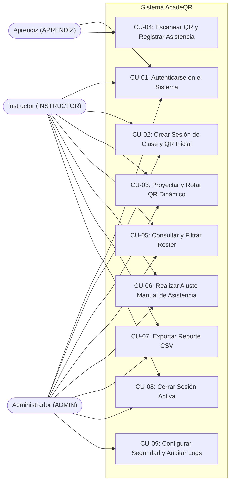
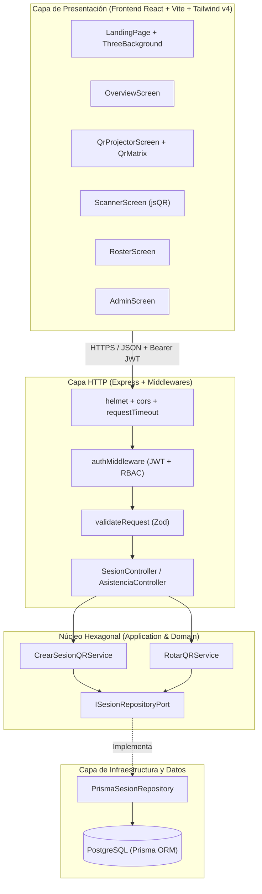
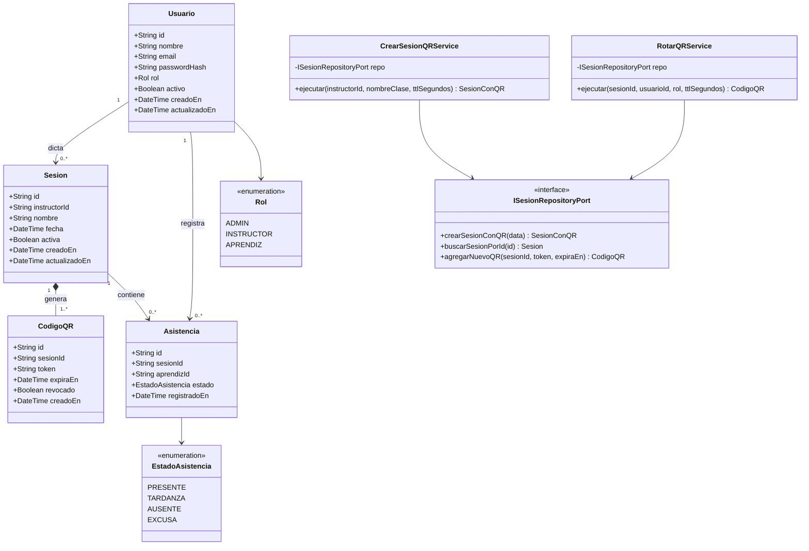
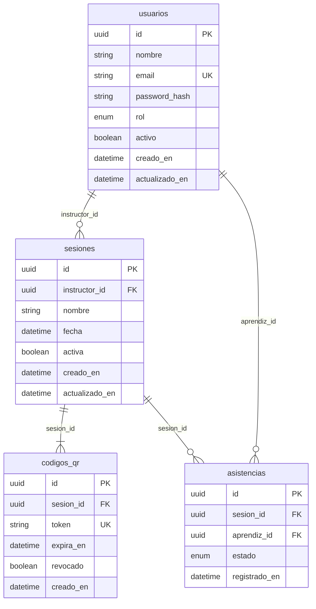
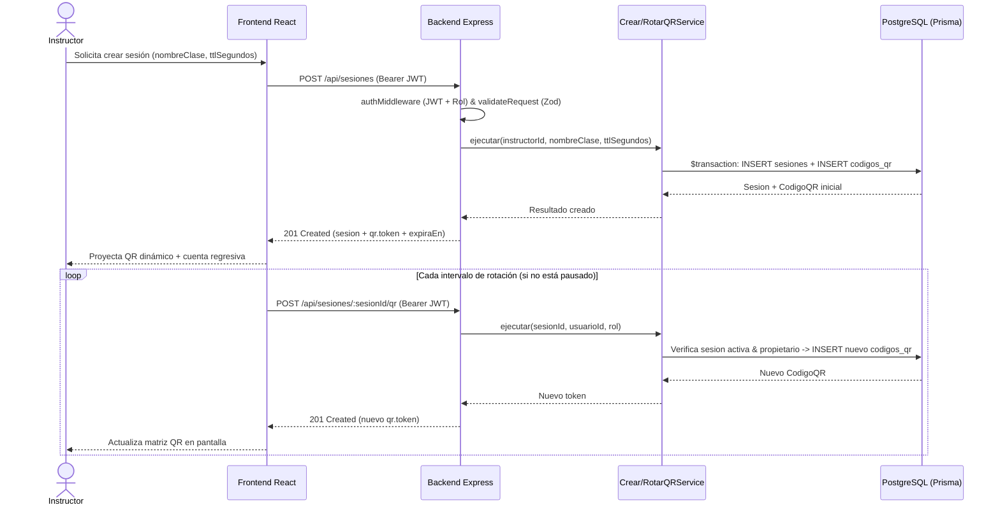
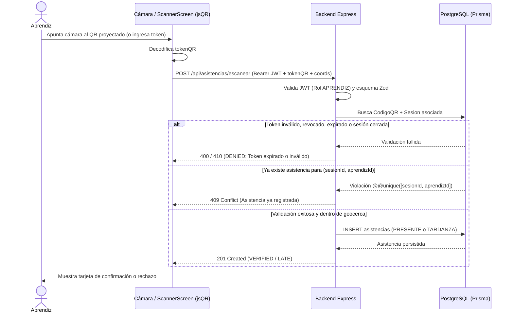
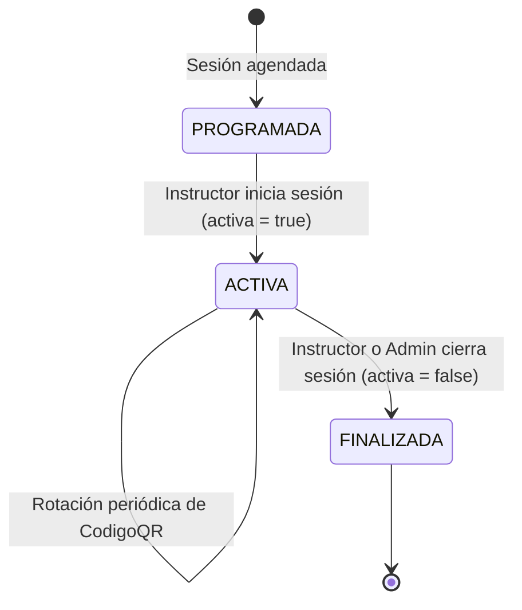
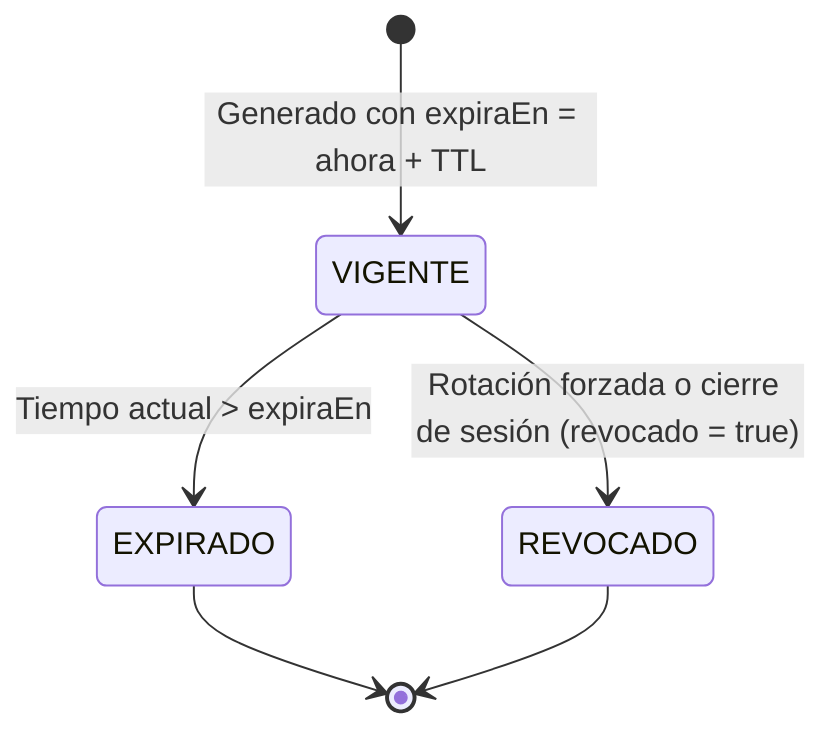
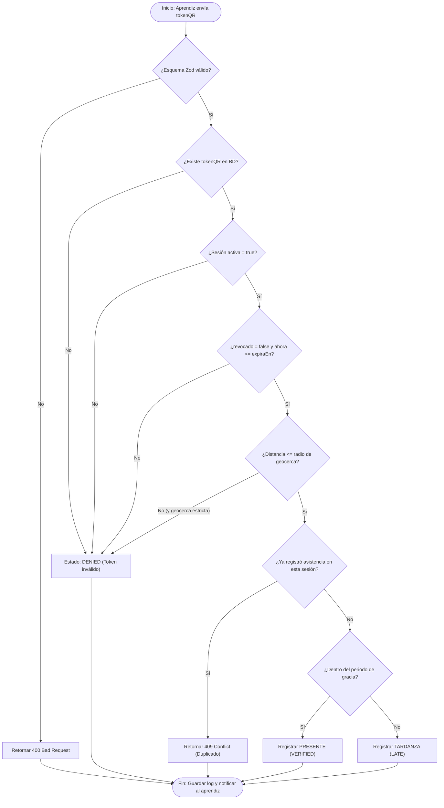

# Especificación de Requisitos de Software (SRS)

> **Estándar:** IEEE 830 / ISO/IEC/IEEE 29148  
> **Proyecto:** Sistema de Control de Asistencia mediante Código QR (`AcadeQR`)  
> **Versión:** 2.0  
> **Fecha:** 2026-11-17  

---

## Tabla de Contenido

1. [Introducción](#1-introducción)
2. [Descripción General del Sistema](#2-descripción-general-del-sistema)
3. [Requisitos Específicos](#3-requisitos-específicos)
   - [3.1 Requisitos Funcionales (RF)](#31-requisitos-funcionales-rf)
   - [3.2 Requisitos No Funcionales (RNF)](#32-requisitos-no-funcionales-rnf)
   - [3.3 Requisitos de Interfaces Externas](#33-requisitos-de-interfaces-externas)
4. [Modelado de Casos de Uso (UML)](#4-modelado-de-casos-de-uso-uml)
   - [4.1 Diagrama General de Casos de Uso](#41-diagrama-general-de-casos-de-uso)
   - [4.2 Especificación Detallada de Casos de Uso](#42-especificación-detallada-de-casos-de-uso)
5. [Diagramas UML y Modelado del Sistema](#5-diagramas-uml-y-modelado-del-sistema)
   - [5.1 Diagrama de Arquitectura del Sistema](#51-diagrama-de-arquitectura-del-sistema)
   - [5.2 Diagrama de Clases (UML)](#52-diagrama-de-clases-uml)
   - [5.3 Diagrama Entidad-Relación (ER)](#53-diagrama-entidad-relación-er)
   - [5.4 Diagramas de Secuencia (UML)](#54-diagramas-de-secuencia-uml)
   - [5.5 Diagramas de Estados (UML)](#55-diagramas-de-estados-uml)
   - [5.6 Diagrama de Actividades: Validación de Escaneo QR](#56-diagrama-de-actividades-validación-de-escaneo-qr)
6. [Matriz de Trazabilidad](#6-matriz-de-trazabilidad)

---

## 1. Introducción

### 1.1 Propósito
El presente documento define la Especificación de Requisitos de Software (SRS) bajo el estándar **IEEE 830 / ISO/IEC/IEEE 29148** para el **Sistema de Control de Asistencia mediante Código QR (`AcadeQR`)**. Su objetivo es establecer de forma precisa, verificable y trazable los requisitos funcionales, no funcionales, interfaces, casos de uso y modelos arquitectónicos UML que rigen el diseño, desarrollo y validación del sistema.

### 1.2 Alcance
**AcadeQR** es una plataforma web institucional (*Mobile-First* en cliente y API REST hexagonal en servidor) diseñada para automatizar el registro, verificación criptográfica y auditoría de asistencia en sesiones de formación académica o técnica. El sistema:
- Genera **códigos QR dinámicos con tiempo de vida (TTL)** configurable y rotación periódica para proyectar en el aula.
- Permite el **escaneo móvil en tiempo real** (cámara vía `jsQR` o ingreso manual de token) con validación de vigencia, firma criptográfica, unicidad por sesión/aprendiz y radio de geocerca.
- Proporciona gestión integral de listados (**Roster**), ajustes manuales justificados por el instructor, exportación de reportes en **CSV**, panel de monitoreo institucional y panel administrativo de configuración de seguridad.

### 1.3 Definiciones, Acrónimos y Abreviaturas
| Término | Definición |
| :--- | :--- |
| **AcadeQR** | Nombre del sistema institucional de control de asistencia mediante códigos QR dinámicos. |
| **RBAC** | *Role-Based Access Control* (Control de Acceso Basado en Roles: `ADMIN`, `INSTRUCTOR`, `APRENDIZ`). |
| **JWT** | *JSON Web Token*. Token firmado utilizado para autenticar sesiones de usuario en la API. |
| **TTL** | *Time-To-Live*. Tiempo de vigencia en segundos de un código QR dinámico antes de expirar. |
| **HMAC** | *Hash-based Message Authentication Code*. Mecanismo criptográfico para firmar y validar tokens QR. |
| **SRS** | *Software Requirements Specification* (Especificación de Requisitos de Software). |
| **Roster** | Listado oficial de aprendices vinculados a una ficha o sesión de formación con su estado de asistencia. |
| **Geocerca** | Perímetro geográfico máximo permitido (en metros) alrededor del aula para validar un escaneo presencial. |

### 1.4 Referencias
- Estándar **IEEE Std 830-1998** / **ISO/IEC/IEEE 29148** para Especificación de Requisitos de Software.
- Esquema de Base de Datos Prisma: `backend/prisma/schema.prisma`.
- Contrato de API REST: `docs/03-api-contract.md`.
- Diccionario de Datos: `docs/02-diccionario-datos.md`.
- Casos de Prueba: `docs/04-casos-prueba.md`.

---

## 2. Descripción General del Sistema

### 2.1 Perspectiva del Producto
AcadeQR opera bajo una arquitectura cliente-servidor desacoplada:
- **Frontend (SPA React + Vite + TypeScript + Tailwind CSS v4):** Incluye portal de bienvenida (`LandingPage` con fondo 3D `ThreeBackground`), tablero general (`OverviewScreen`), proyector QR dinámico (`QrProjectorScreen`), escáner móvil (`ScannerScreen` con `jsQR`), gestor de asistencia (`RosterScreen`) y panel administrativo (`AdminScreen`).
- **Backend (Node.js + Express + TypeScript + Prisma ORM):** Implementado con **Arquitectura Hexagonal** (Puertos y Adaptadores), separando dominio, servicios de aplicación, validadores **Zod** y adaptadores HTTP/PostgreSQL.
- **Base de Datos (PostgreSQL):** Persistencia relacional transaccional con restricciones de unicidad e integridad referencial.

### 2.2 Funciones Principales del Producto
1. Autenticación de usuarios y autorización por roles (`ADMIN`, `INSTRUCTOR`, `APRENDIZ`).
2. Creación atómica de sesiones de formación y emisión de código QR inicial con TTL.
3. Rotación automática y manual de tokens QR dinámicos en tiempo real.
4. Proyección de QR de alto contraste en aula con cuenta regresiva visual y estado de vigencia.
5. Escaneo de QR desde cámara móvil o token manual con verificación de TTL, firma, geocerca y unicidad.
6. Gestión de asistencia por sesión (`PRESENTE`, `TARDANZA`, `AUSENTE`, `EXCUSA`), anulación/ajuste manual y exportación CSV.
7. Auditoría de eventos de escaneo y configuración global de parámetros criptográficos y de geocerca.

### 2.3 Características de los Usuarios (Actores RBAC)
| Rol (`enum Rol`) | Perfil de Usuario | Responsabilidades y Capacidades |
| :--- | :--- | :--- |
| **`ADMIN`** | Administrador o coordinador institucional | Supervisa métricas globales, gestiona parámetros de seguridad (algoritmo HMAC, TTL por defecto, geocerca máxima), audita logs y puede crear, rotar o cerrar cualquier sesión. |
| **`INSTRUCTOR`** | Docente o instructor de ficha | Crea sesiones de clase, proyecta el QR dinámico en aula, pausa/reanuda o fuerza la rotación del QR, gestiona el roster, aplica ajustes manuales y exporta reportes CSV. |
| **`APRENDIZ`** | Estudiante / participante | Se autentica en el sistema, escanea el código QR vigente desde su dispositivo móvil dentro del aula y visualiza la confirmación o rechazo inmediato de su registro. |

### 2.4 Restricciones, Suposiciones y Dependencias
- **Restricciones:**
  - Un aprendiz no puede registrar más de una asistencia por sesión (`@@unique([sesionId, aprendizId])`).
  - Los secretos `JWT_SECRET` y `QR_SECRET` deben ser distintos y validados al iniciar el servidor.
  - El `ttlSegundos` de una sesión debe estar estrictamente entre `10` y `7200` segundos.
- **Suposiciones:**
  - Los dispositivos de los aprendices cuentan con cámara web funcional o capacidad de ingresar el token manual, y conectividad HTTP(S) hacia el servidor.
  - La hora del servidor está sincronizada (NTP) para evitar desfases en el cálculo de expiración `expiraEn`.
- **Dependencias:** Node.js, PostgreSQL, Prisma ORM, Express, Zod, React 19, Vite, Tailwind CSS v4, `qrcode`, `jsqr`, `three`.

---

## 3. Requisitos Específicos

### 3.1 Requisitos Funcionales (RF)

| ID | Nombre | Descripción Detallada | Actor(es) | Prioridad |
| :--- | :--- | :--- | :--- | :--- |
| **RF-01** | Autenticación y Emisión de JWT | El sistema debe autenticar usuarios mediante correo y contraseña verificada, emitiendo un token JWT firmado con `JWT_SECRET` que incluya `sub` (ID de usuario) y `rol`. | Todos | Alta |
| **RF-02** | Creación Atómica de Sesión y QR | El sistema debe permitir crear una sesión especificando `nombreClase` y `ttlSegundos` (10 a 7200s), persistiendo atómicamente la `Sesion` y su primer `CodigoQR` con token único y fecha de expiración. | `INSTRUCTOR`, `ADMIN` | Alta |
| **RF-03** | Rotación Dinámica de Código QR | El sistema debe permitir rotar el código QR de una sesión activa (manualmente o por temporizador), generando un nuevo `CodigoQR` y manteniendo la trazabilidad de la sesión. | `INSTRUCTOR`, `ADMIN` | Alta |
| **RF-04** | Proyección de QR en Aula | La interfaz debe proyectar el código QR en alta resolución y alto contraste junto con un temporizador tabular regresivo, selector de intervalo de rotación y controles de pausa/rotación inmediata. | `INSTRUCTOR` | Alta |
| **RF-05** | Escaneo Móvil y Lectura por Cámara | La interfaz del aprendiz debe permitir activar la cámara del dispositivo para decodificar el QR en tiempo real mediante `jsQR`, o ingresar el token manualmente como respaldo. | `APRENDIZ` | Alta |
| **RF-06** | Validación de Token, TTL y Unicidad | Al recibir un intento de escaneo, el sistema debe validar que la sesión esté activa, que el token exista, no esté revocado ni expirado (`expiraEn > ahora`), y que el aprendiz no tenga asistencia previa en esa sesión. | Sistema | Crítica |
| **RF-07** | Validación de Geocerca y Periodo de Gracia | El sistema debe verificar la distancia estimada frente al radio de geocerca configurado (`geofenceRadiusMeters`) y evaluar el `gracePeriodMinutes` para clasificar el registro como `PRESENTE` (verificado), `TARDANZA` o `DENEGADO`. | Sistema | Alta |
| **RF-08** | Gestión de Listado (Roster) y Filtro | El instructor debe poder consultar el listado de aprendices de la sesión, buscar por nombre o documento, filtrar por estado (`PRESENT`, `LATE`, `ABSENT`) y visualizar hora y método de registro. | `INSTRUCTOR`, `ADMIN` | Alta |
| **RF-09** | Ajuste Manual de Asistencia | El instructor debe poder modificar manualmente el estado de un aprendiz (`Instructor Override`) registrando la marca temporal y conservando la auditoría del cambio. | `INSTRUCTOR`, `ADMIN` | Media |
| **RF-10** | Exportación de Reporte CSV | El sistema debe generar y descargar un archivo `.csv` con el detalle de asistencia de la sesión seleccionada (ficha, aprendiz, documento, estado, hora, método y firma). | `INSTRUCTOR`, `ADMIN` | Media |
| **RF-11** | Cierre de Sesión de Clase | El instructor propietario o un administrador debe poder finalizar una sesión activa (`activa = false` / `COMPLETED`), bloqueando futuras rotaciones de QR y nuevos escaneos. | `INSTRUCTOR`, `ADMIN` | Alta |
| **RF-12** | Tablero General y Métricas Institucionales | El sistema debe mostrar en `OverviewScreen` el resumen de sesiones en vivo, programadas y finalizadas, porcentajes de asistencia y accesos rápidos a proyección, escáner y listado. | `INSTRUCTOR`, `ADMIN` | Media |
| **RF-13** | Registro de Auditoría de Escaneos | El sistema debe registrar cada intento de escaneo (exitoso, tardío o denegado) con marca temporal, aprendiz, distancia, token utilizado y motivo para trazabilidad en tiempo real. | `ADMIN`, `INSTRUCTOR` | Media |
| **RF-14** | Configuración Global de Seguridad (Admin) | El administrador debe poder visualizar y ajustar parámetros institucionales en `AdminScreen`: TTL por defecto, radio máximo de geocerca, aplicación estricta de geocerca, protección anti-manipulación y permiso de ajuste manual. | `ADMIN` | Media |

---

### 3.2 Requisitos No Funcionales (RNF)

| ID | Categoría | Descripción del Requisito | Criterio de Aceptación / Mecanismo Técnico |
| :--- | :--- | :--- | :--- |
| **RNF-01** | Seguridad | Validación estricta de esquemas de entrada antes de ejecutar cualquier caso de uso. | Middleware `validateRequest.ts` con esquemas **Zod** en backend y validación tipada en frontend. |
| **RNF-02** | Seguridad | Separación obligatoria de claves criptográficas para autenticación de usuario y firma de tokens QR. | Variables `JWT_SECRET` y `QR_SECRET` validadas al arranque en `backend/src/config/env.ts` (falla rápida si son iguales o débiles). |
| **RNF-03** | Seguridad | Protección de cabeceras HTTP, control de orígenes permitidos y mitigación de ataques comunes. | Middlewares `helmet` y `cors` configurados en `backend/src/app.ts`. |
| **RNF-04** | Integridad de Datos | Garantía de atomicidad en la creación de sesión y QR inicial, y unicidad absoluta de asistencia. | Uso de `prisma.$transaction` en `PrismaSesionRepository` y restricción `@@unique([sesionId, aprendizId])` en PostgreSQL. |
| **RNF-05** | Rendimiento | El tiempo de respuesta de los endpoints de creación, rotación y verificación de asistencia debe ser inferior a `300 ms` en condiciones normales. | Consultas indexadas (`@@index([instructorId, activa])`, `@@index([sesionId, expiraEn, revocado])`) y middleware `requestTimeout.ts`. |
| **RNF-06** | Disponibilidad y Confiabilidad | Manejo centralizado y predecible de errores sin exponer trazas internas en producción. | `errorHandler.ts` y clase `AppError.ts` con respuestas JSON estandarizadas (`apiResponse.ts`). |
| **RNF-07** | Mantenibilidad | Desacoplamiento estricto entre reglas de negocio, infraestructura HTTP y motor de base de datos. | **Arquitectura Hexagonal** (`domain/ports`, `application/services`, `infrastructure/controllers`, `infrastructure/repositories`). |
| **RNF-08** | Usabilidad | Interfaz optimizada para operación móvil con una sola mano (*Mobile-First*) y lectura rápida bajo iluminación variable en aula. | Diseño con **Tailwind CSS v4**, botones de altura mínima ergonómica (`48px–52px`), números tabulares (`tnum`) y estados semánticos de alto contraste. |
| **RNF-09** | Portabilidad | Compatibilidad con navegadores modernos de escritorio y móviles (Chrome, Edge, Safari, Firefox) sin instalación nativa requerida. | Aplicación Web Progresiva SPA construida con React 19 + Vite y API estándar `MediaDevices.getUserMedia`. |
| **RNF-10** | Trazabilidad | Todo cambio de estado o intento de registro debe quedar asociado a un identificador único UUID y marca temporal UTC/ISO-8601. | Claves primarias `@default(uuid())` y campos `creadoEn`, `actualizadoEn`, `registradoEn` en todas las tablas. |

---

### 3.3 Requisitos de Interfaces Externas

#### 3.3.1 Interfaces de Usuario (Pantallas del Sistema)
| Pantalla | Componente | Propósito |
| :--- | :--- | :--- |
| **Portal Inicial** | `LandingPage.tsx` + `ThreeBackground.tsx` | Presentación institucional interactiva con fondo WebGL 3D y acceso directo a la plataforma. |
| **Resumen Operativo** | `OverviewScreen.tsx` | KPIs institucionales, estado de sesiones (`LIVE`, `SCHEDULED`, `COMPLETED`) y navegación rápida. |
| **Proyector QR** | `QrProjectorScreen.tsx` + `QrMatrix.tsx` | Proyección del código QR dinámico, anillo/barra de cuenta regresiva, intervalo de rotación y pausado. |
| **Escáner Móvil** | `ScannerScreen.tsx` | Visor de cámara con `jsQR`, entrada de token manual, selector de aprendiz demo y tarjeta de veredicto (`VERIFIED`, `LATE`, `DENIED`). |
| **Listado (Roster)** | `RosterScreen.tsx` + `StatusBadge.tsx` | Tabla/tarjetas de aprendices, búsqueda con `useDebouncedValue`, filtros, override manual y descarga CSV. |
| **Administración** | `AdminScreen.tsx` | Configuración de parámetros criptográficos, TTL, geocerca y auditoría de eventos de escaneo. |

#### 3.3.2 Interfaces de Hardware
- **Cámara del dispositivo móvil/portátil:** Requerida para el escaneo óptico en tiempo real vía `navigator.mediaDevices.getUserMedia`.
- **Proyector o pantalla de aula:** Para la visualización del QR dinámico a distancia por los aprendices.
- **Módulo de geolocalización (GPS/Wi-Fi):** Para la validación de proximidad dentro del radio de geocerca.

#### 3.3.3 Interfaces de Software y Comunicaciones
- **Protocolo:** HTTP/HTTPS con intercambio de datos en formato `application/json` y autenticación `Authorization: Bearer <JWT>`.
- **Endpoints principales:**
  - `POST /api/auth/login` (Autenticación JWT)
  - `POST /api/sesiones` (Crear sesión + QR inicial)
  - `POST /api/sesiones/:sesionId/qr` (Rotar token QR)
  - `PATCH /api/sesiones/:sesionId/cerrar` (Cerrar sesión activa)
  - `POST /api/asistencias/escanear` (Registrar asistencia vía QR)
  - `GET /api/sesiones/:sesionId/asistencias` (Consultar roster)
- **Motor de Persistencia:** PostgreSQL gestionado mediante **Prisma ORM**.

---

## 4. Modelado de Casos de Uso (UML)

### 4.1 Diagrama General de Casos de Uso

---

### 4.2 Especificación Detallada de Casos de Uso

#### CU-01: Autenticarse en el Sistema
- **Actor Principal:** Administrador, Instructor, Aprendiz.
- **Precondiciones:** El usuario debe estar registrado y activo (`activo = true`) en la base de datos.
- **Flujo Principal:**
  1. El usuario ingresa su correo electrónico y contraseña.
  2. El sistema valida el formato de entrada mediante Zod.
  3. El sistema verifica el hash de la contraseña y genera un token JWT con `sub` y `rol`.
  4. El sistema retorna el JWT y habilita las vistas correspondientes al rol.
- **Flujos Alternos / Excepciones:**
  - *4a.* Credenciales inválidas o usuario inactivo: el sistema responde `401 Unauthorized` y muestra mensaje de error sin revelar qué campo falló.
- **Postcondiciones:** El cliente almacena el token JWT para autenticar peticiones posteriores.

#### CU-02: Crear Sesión de Clase y QR Inicial
- **Actor Principal:** Instructor (o Administrador).
- **Precondiciones:** Usuario autenticado con rol `INSTRUCTOR` o `ADMIN`.
- **Flujo Principal:**
  1. El instructor ingresa el nombre de la clase (`nombreClase`) y el tiempo de vida (`ttlSegundos`, entre 10 y 7200s).
  2. El sistema valida el JWT, el rol y el esquema de entrada.
  3. Mediante una transacción atómica (`prisma.$transaction`), el sistema crea el registro en `sesiones` y el primer token único en `codigos_qr`.
  4. El sistema retorna `201 Created` con los datos de la sesión y el primer `CodigoQR`.
- **Flujos Alternos / Excepciones:**
  - *2a.* `ttlSegundos` fuera de rango o `nombreClase` vacío: responde `400 Bad Request`.
  - *2b.* Rol no autorizado (`APRENDIZ`): responde `403 Forbidden`.
- **Postcondiciones:** Existe una sesión activa lista para proyectar su código QR.

#### CU-03: Proyectar y Rotar QR Dinámico
- **Actor Principal:** Instructor (o Administrador).
- **Precondiciones:** Existe una sesión con `activa = true` y el instructor es propietario (o el usuario es `ADMIN`).
- **Flujo Principal:**
  1. El instructor abre la vista `QrProjectorScreen`.
  2. El sistema renderiza el código QR actual y activa la cuenta regresiva.
  3. Al finalizar el intervalo o al pulsar rotación manual, el sistema invoca `POST /api/sesiones/:sesionId/qr`.
  4. El servidor genera un nuevo `CodigoQR` con nuevo `token` y `expiraEn`, y actualiza el proyector.
- **Flujos Alternos / Excepciones:**
  - *3a.* El instructor pausa la rotación: el temporizador se detiene manteniendo el último estado visual hasta reanudar.
  - *3b.* La sesión ya fue cerrada (`activa = false`): el backend rechaza la rotación con `409 Conflict` / `400 Bad Request`.
- **Postcondiciones:** Se emite un nuevo token QR vigente sin perder el historial de tokens previos.

#### CU-04: Escanear QR y Registrar Asistencia
- **Actor Principal:** Aprendiz.
- **Precondiciones:** El aprendiz está autenticado y la sesión está activa con un QR vigente proyectado.
- **Flujo Principal:**
  1. El aprendiz abre `ScannerScreen` en su móvil y apunta la cámara al QR proyectado (o ingresa el token manualmente).
  2. `jsQR` decodifica el token y lo envía junto con los datos de ubicación al servidor.
  3. El sistema verifica: sesión activa, existencia del token, `revocado = false`, `expiraEn > ahora`, distancia dentro del radio de geocerca y ausencia de registro previo para `(sesionId, aprendizId)`.
  4. El sistema evalúa si está dentro del periodo de gracia (`PRESENTE` o `TARDANZA`), persiste en `asistencias` y muestra la tarjeta de confirmación.
- **Flujos Alternos / Excepciones:**
  - *3a.* Token expirado o revocado: responde `400/410` y muestra estado `DENIED`.
  - *3b.* Fuera de geocerca (cuando está estrictamente habilitada): rechaza el registro como `DENIED`.
  - *3c.* Registro duplicado en la misma sesión: responde `409 Conflict` indicando que la asistencia ya fue registrada.
- **Postcondiciones:** Queda registrada la asistencia única del aprendiz y el evento en el log de auditoría.

#### CU-05: Consultar y Filtrar Roster
- **Actor Principal:** Instructor (o Administrador).
- **Precondiciones:** Sesión existente en el sistema.
- **Flujo Principal:**
  1. El instructor accede a `RosterScreen`.
  2. El sistema muestra la lista de aprendices con su avatar/iniciales, documento, estado (`PRESENT`, `LATE`, `ABSENT`), hora y método.
  3. El instructor puede buscar por texto (con *debounce*) o filtrar por estado.
- **Postcondiciones:** Visualización actualizada del estado de asistencia del grupo.

#### CU-06: Realizar Ajuste Manual de Asistencia
- **Actor Principal:** Instructor (o Administrador).
- **Precondiciones:** La configuración institucional permite `allowManualOverride = true`.
- **Flujo Principal:**
  1. En `RosterScreen`, el instructor selecciona un aprendiz y cambia su estado manualmente.
  2. El sistema actualiza el estado, asigna el método `Instructor Override` y registra la hora del ajuste.
- **Postcondiciones:** El estado del aprendiz queda actualizado y reflejado en métricas y exportaciones.

#### CU-07: Exportar Reporte CSV
- **Actor Principal:** Instructor (o Administrador).
- **Precondiciones:** Sesión seleccionada con datos en el roster.
- **Flujo Principal:**
  1. El usuario presiona el botón de exportación CSV.
  2. El sistema recopila los registros de la sesión y genera un archivo `.csv` descargable con codificación UTF-8.
- **Postcondiciones:** El archivo CSV se descarga en el equipo del usuario.

#### CU-08: Cerrar Sesión Activa
- **Actor Principal:** Instructor propietario o Administrador.
- **Precondiciones:** La sesión se encuentra en estado `activa = true`.
- **Flujo Principal:**
  1. El instructor solicita finalizar la sesión.
  2. El sistema actualiza `activa = false` en `sesiones` y revoca los códigos QR pendientes.
- **Postcondiciones:** No se permiten nuevas rotaciones ni registros de asistencia sobre la sesión cerrada.

#### CU-09: Configurar Seguridad y Auditar Logs
- **Actor Principal:** Administrador.
- **Precondiciones:** Usuario autenticado con rol `ADMIN`.
- **Flujo Principal:**
  1. El administrador ingresa a `AdminScreen`.
  2. Ajusta parámetros como TTL por defecto, radio de geocerca, modo estricto o permiso de override manual.
  3. Consulta el historial en tiempo real de eventos de escaneo (`ScanEventLog`) para detectar intentos fallidos o anomalías.
- **Postcondiciones:** Las políticas globales del sistema quedan actualizadas.

---

## 5. Diagramas UML y Modelado del Sistema

### 5.1 Diagrama de Arquitectura del Sistema

---

### 5.2 Diagrama de Clases (UML)

---

### 5.3 Diagrama Entidad-Relación (ER)

Basado directamente en `backend/prisma/schema.prisma`:

> **Restricción crítica de integridad:** La tabla `asistencias` posee el índice único compuesto `@@unique([sesion_id, aprendiz_id])` para impedir registros duplicados de un mismo aprendiz en la misma sesión.

---

### 5.4 Diagramas de Secuencia (UML)

#### Secuencia A: Creación de Sesión, Proyección y Rotación Dinámica de QR

#### Secuencia B: Escaneo Móvil de Asistencia y Validación

---

### 5.5 Diagramas de Estados (UML)

#### Ciclo de Vida de una Sesión (`Sesion`)

#### Ciclo de Vida de un Código QR (`CodigoQR`)

---

### 5.6 Diagrama de Actividades: Validación de Escaneo QR

---

## 6. Matriz de Trazabilidad

| Requisito | Caso(s) de Uso | Componente Frontend | Artefacto Backend | Tabla(s) BD |
| :--- | :--- | :--- | :--- | :--- |
| **RF-01** | CU-01 | Flujo de autenticación | `authMiddleware.ts`, `env.ts` | `usuarios` |
| **RF-02** | CU-02 | `OverviewScreen.tsx`, `QrProjectorScreen.tsx` | `CrearSesionQRService`, `sesion.controller.ts` | `sesiones`, `codigos_qr` |
| **RF-03** | CU-03 | `App.tsx`, `QrProjectorScreen.tsx` | `RotarQRService`, `sesion.routes.ts` | `sesiones`, `codigos_qr` |
| **RF-04** | CU-03 | `QrProjectorScreen.tsx`, `QrMatrix.tsx` | `RotarQRService` | `codigos_qr` |
| **RF-05** | CU-04 | `ScannerScreen.tsx`, `qrParser.ts` | Endpoint `/api/asistencias/escanear` | `codigos_qr`, `asistencias` |
| **RF-06** | CU-04 | `ScannerScreen.tsx` | Validación TTL + `@@unique` Prisma | `codigos_qr`, `asistencias` |
| **RF-07** | CU-04 | `ScannerScreen.tsx` | Lógica de geocerca y gracia | `asistencias` |
| **RF-08** | CU-05 | `RosterScreen.tsx`, `StatusBadge.tsx`, `useDebouncedValue.ts` | Consulta de asistencias por sesión | `asistencias`, `usuarios` |
| **RF-09** | CU-06 | `RosterScreen.tsx` | Actualización de estado de asistencia | `asistencias` |
| **RF-10** | CU-07 | `RosterScreen.tsx`, `mockInstitution.ts` | Exportación de datos de sesión | `asistencias`, `sesiones` |
| **RF-11** | CU-08 | `OverviewScreen.tsx`, `QrProjectorScreen.tsx` | Endpoint `PATCH /api/sesiones/:sesionId/cerrar` | `sesiones`, `codigos_qr` |
| **RF-12** | CU-05, CU-09 | `OverviewScreen.tsx` | Agregación de sesiones y métricas | `sesiones`, `asistencias` |
| **RF-13** | CU-09 | `AdminScreen.tsx` | Auditoría de eventos de escaneo | `asistencias`, `codigos_qr` |
| **RF-14** | CU-09 | `AdminScreen.tsx` | Configuración institucional de seguridad | Parámetros de sistema |
| **RNF-01..06** | Todos | Validaciones de formularios | `validateRequest.ts`, `helmet`, `cors`, `errorHandler.ts`, `requestTimeout.ts` | Todas |
| **RNF-07..10** | Todos | React 19 + Tailwind CSS v4 + `index.css` | Arquitectura Hexagonal + Prisma UUID | Todas |
