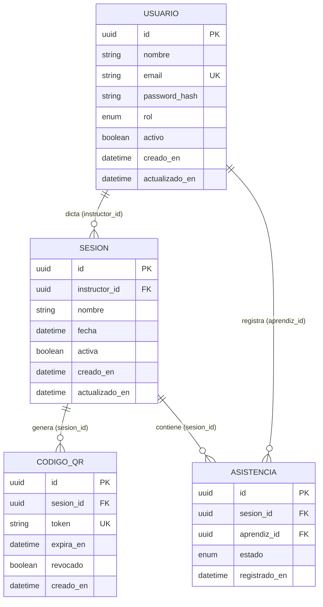

# Diccionario de Datos — PostgreSQL (Prisma ORM)

> **Motor:** PostgreSQL  
> **Fuente de verdad:** `backend/prisma/schema.prisma`

---

## 1. Diagrama Entidad-Relación

---

## 2. Tipos Enumerados (`ENUM`)

### `Rol`
| Valor | Descripción |
| :--- | :--- |
| `ADMIN` | Administrador del sistema con acceso total. |
| `INSTRUCTOR` | Docente autorizado para crear sesiones y generar/rotar códigos QR. |
| `APRENDIZ` | Estudiante habilitado para registrar su asistencia mediante escaneo QR. |

### `EstadoAsistencia`
| Valor | Descripción |
| :--- | :--- |
| `PRESENTE` | Asistencia registrada dentro del tiempo esperado. |
| `TARDANZA` | Asistencia registrada posterior al margen de gracia. |
| `AUSENTE` | Sin registro de asistencia en la sesión. |
| `EXCUSA` | Inasistencia justificada administrativamente. |

---

## 3. Definición de Tablas

### 3.1 Tabla `usuarios` (Modelo `Usuario`)

| Columna (BD) | Campo (Prisma) | Tipo PostgreSQL | Restricciones | Descripción |
| :--- | :--- | :--- | :--- | :--- |
| `id` | `id` | `UUID` / `TEXT` | `PRIMARY KEY`, `DEFAULT uuid()` | Identificador único del usuario. |
| `nombre` | `nombre` | `TEXT` | `NOT NULL` | Nombre completo del usuario. |
| `email` | `email` | `TEXT` | `NOT NULL`, `UNIQUE` | Correo electrónico institucional (identificador de acceso). |
| `password_hash` | `passwordHash` | `TEXT` | `NOT NULL` | Contraseña almacenada con hash seguro. |
| `rol` | `rol` | `Rol` | `NOT NULL`, `DEFAULT 'APRENDIZ'` | Rol asignado para control RBAC. |
| `activo` | `activo` | `BOOLEAN` | `NOT NULL`, `DEFAULT true` | Indica si la cuenta está habilitada. |
| `creado_en` | `creadoEn` | `TIMESTAMP(3)` | `NOT NULL`, `DEFAULT now()` | Fecha y hora de creación del registro. |
| `actualizado_en` | `actualizadoEn` | `TIMESTAMP(3)` | `NOT NULL`, `@updatedAt` | Última fecha de actualización. |

**Índices:**
- `idx_usuarios_rol_activo` sobre `(rol, activo)` para filtrar listados de instructores o aprendices activos.

---

### 3.2 Tabla `sesiones` (Modelo `Sesion`)

| Columna (BD) | Campo (Prisma) | Tipo PostgreSQL | Restricciones | Descripción |
| :--- | :--- | :--- | :--- | :--- |
| `id` | `id` | `UUID` / `TEXT` | `PRIMARY KEY`, `DEFAULT uuid()` | Identificador único de la sesión de clase. |
| `instructor_id` | `instructorId` | `UUID` / `TEXT` | `NOT NULL`, `FK -> usuarios(id)` (`ON DELETE RESTRICT`) | Instructor responsable de la sesión. |
| `nombre` | `nombre` | `TEXT` | `NOT NULL` | Nombre de la clase, asignatura o jornada. |
| `fecha` | `fecha` | `TIMESTAMP(3)` | `NOT NULL`, `DEFAULT now()` | Fecha programada o de inicio de la sesión. |
| `activa` | `activa` | `BOOLEAN` | `NOT NULL`, `DEFAULT true` | Indica si la sesión acepta rotación de QR y registros. |
| `creado_en` | `creadoEn` | `TIMESTAMP(3)` | `NOT NULL`, `DEFAULT now()` | Marca temporal de creación. |
| `actualizado_en` | `actualizadoEn` | `TIMESTAMP(3)` | `NOT NULL`, `@updatedAt` | Última modificación. |

**Índices:**
- `idx_sesiones_instructor_activa` sobre `(instructor_id, activa)`.
- `idx_sesiones_fecha` sobre `(fecha)`.

---

### 3.3 Tabla `codigos_qr` (Modelo `CodigoQR`)

| Columna (BD) | Campo (Prisma) | Tipo PostgreSQL | Restricciones | Descripción |
| :--- | :--- | :--- | :--- | :--- |
| `id` | `id` | `UUID` / `TEXT` | `PRIMARY KEY`, `DEFAULT uuid()` | Identificador único del código QR emitido. |
| `sesion_id` | `sesionId` | `UUID` / `TEXT` | `NOT NULL`, `FK -> sesiones(id)` (`ON DELETE CASCADE`) | Sesión a la que pertenece este QR. |
| `token` | `token` | `TEXT` | `NOT NULL`, `UNIQUE` | Token JWT firmado con `jti` único y tiempo de expiración. |
| `expira_en` | `expiraEn` | `TIMESTAMP(3)` | `NOT NULL` | Fecha y hora exacta de expiración del token. |
| `revocado` | `revocado` | `BOOLEAN` | `NOT NULL`, `DEFAULT false` | Permite invalidar manualmente un QR antes de su TTL. |
| `creado_en` | `creadoEn` | `TIMESTAMP(3)` | `NOT NULL`, `DEFAULT now()` | Marca temporal de emisión del QR. |

**Índices:**
- `idx_codigos_qr_vigencia` sobre `(sesion_id, expira_en, revocado)` para consultar códigos vigentes rápidamente.

---

### 3.4 Tabla `asistencias` (Modelo `Asistencia`)

| Columna (BD) | Campo (Prisma) | Tipo PostgreSQL | Restricciones | Descripción |
| :--- | :--- | :--- | :--- | :--- |
| `id` | `id` | `UUID` / `TEXT` | `PRIMARY KEY`, `DEFAULT uuid()` | Identificador único del registro de asistencia. |
| `sesion_id` | `sesionId` | `UUID` / `TEXT` | `NOT NULL`, `FK -> sesiones(id)` (`ON DELETE RESTRICT`) | Sesión en la que se registra la asistencia. |
| `aprendiz_id` | `aprendizId` | `UUID` / `TEXT` | `NOT NULL`, `FK -> usuarios(id)` (`ON DELETE RESTRICT`) | Aprendiz que registra la asistencia. |
| `estado` | `estado` | `EstadoAsistencia` | `NOT NULL`, `DEFAULT 'PRESENTE'` | Estado de puntualidad o novedad. |
| `registrado_en` | `registradoEn` | `TIMESTAMP(3)` | `NOT NULL`, `DEFAULT now()` | Momento exacto del registro. |

**Restricciones únicas e índices:**
- `UNIQUE (sesion_id, aprendiz_id)`: garantiza idempotencia impidiendo que un mismo aprendiz quede registrado dos veces en la misma sesión.
- `idx_asistencias_aprendiz_fecha` sobre `(aprendiz_id, registrado_en)` para historial del aprendiz.

