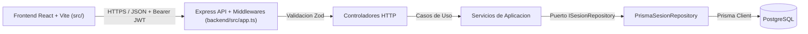

# Documentación Técnica — Sistema de Asistencia QR (AcadeQR)

> **Estándar de referencia:** IEEE 830 / ISO/IEC/IEEE 29148  
> **Repositorio:** `Control-de-Asistencia-mediante-codigo-QR`

---

## 1. Índice de Documentos

| Documento | Contenido | Archivo |
| :--- | :--- | :--- |
| **01. Especificación de Requisitos (SRS)** | Alcance, actores RBAC, requisitos funcionales/no funcionales, matriz de trazabilidad y diagrama de secuencia | [01-srs-ieee830.md](./01-srs-ieee830.md) |
| **02. Diccionario de Datos** | Entidades PostgreSQL (`usuarios`, `sesiones`, `codigos_qr`, `asistencias`), restricciones, índices y diagrama ER | [02-diccionario-datos.md](./02-diccionario-datos.md) |
| **03. Contrato de API REST** | Headers, esquemas Zod, endpoints implementados y proyectados, ejemplos de respuestas `2xx`/`4xx`/`5xx` | [03-api-contract.md](./03-api-contract.md) |
| **04. Casos de Prueba** | Matriz de pruebas para autenticación RBAC, generación/rotación de QR y escaneo de asistencia | [04-casos-prueba.md](./04-casos-prueba.md) |

---

## 2. Arquitectura General del Sistema

El proyecto está organizado en dos capas desacopladas:

1. **Frontend (`src/`)**: Aplicación SPA en **React 19 + Vite + TypeScript + Tailwind CSS v4** con cuatro vistas principales (`OverviewScreen`, `QrProjectorScreen`, `ScannerScreen`, `RosterScreen`).
2. **Backend (`backend/`)**: API REST en **Node.js + Express + TypeScript + Prisma ORM + PostgreSQL + Zod**, estructurada bajo **Arquitectura Hexagonal (Clean Architecture)** con separación en `domain`, `application` e `infrastructure`.



---

## 3. Estructura de Carpetas

```text
Control-de-Asistencia-mediante-codigo-QR/
├── src/                               # Frontend React + Vite
│   ├── components/
│   │   ├── OverviewScreen.tsx         # Panel general de sesiones
│   │   ├── QrProjectorScreen.tsx      # Proyección de QR dinámico
│   │   ├── ScannerScreen.tsx          # Escáner de asistencia
│   │   ├── RosterScreen.tsx           # Listado y control de aprendices
│   │   ├── QrMatrix.tsx               # Renderizado visual de matriz QR
│   │   └── StatusBadge.tsx            # Indicadores de estado
│   ├── data/mockInstitution.ts        # Datos iniciales simulados (transición a API)
│   ├── types/attendance.ts            # Tipos de dominio en frontend
│   └── App.tsx                        # Enrutamiento de vistas y motor de rotación local
├── backend/                           # Backend Node.js + Express + Prisma
│   ├── prisma/schema.prisma           # Modelo relacional PostgreSQL
│   └── src/
│       ├── config/env.ts              # Validación de variables de entorno con Zod
│       ├── shared/                    # AppError y apiResponse estandarizado
│       ├── infrastructure/            # Prisma singleton, authMiddleware, errorHandler, validateRequest
│       └── modules/sesiones/          # Módulo hexagonal de Sesiones y QR Dinámico
└── docs/                              # Documentación técnica (IEEE 830 / ISO 29148)
```

---

## 4. Puesta en Marcha Rápida

### Backend
```bash
cd backend
cp .env.example .env
npm install
npx prisma generate
npx prisma migrate dev --name init
npm run dev
```

### Frontend
```bash
npm install
npm run dev
```

